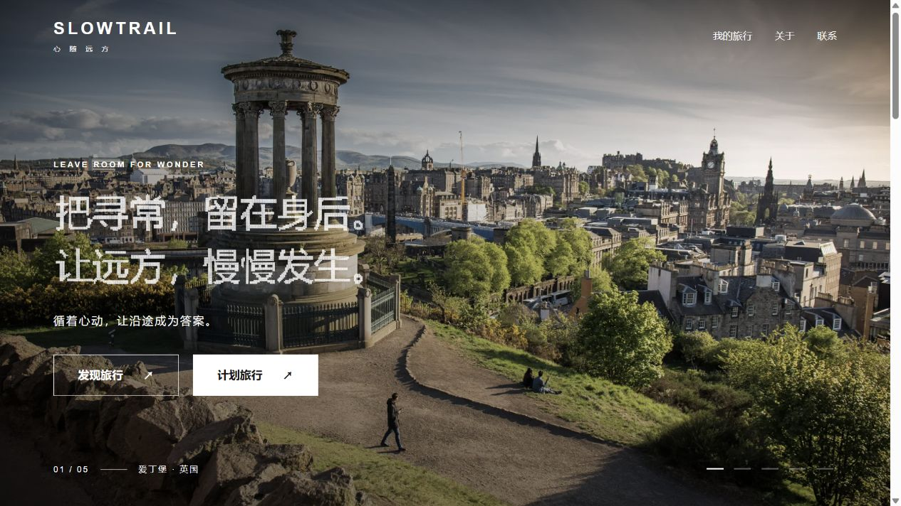
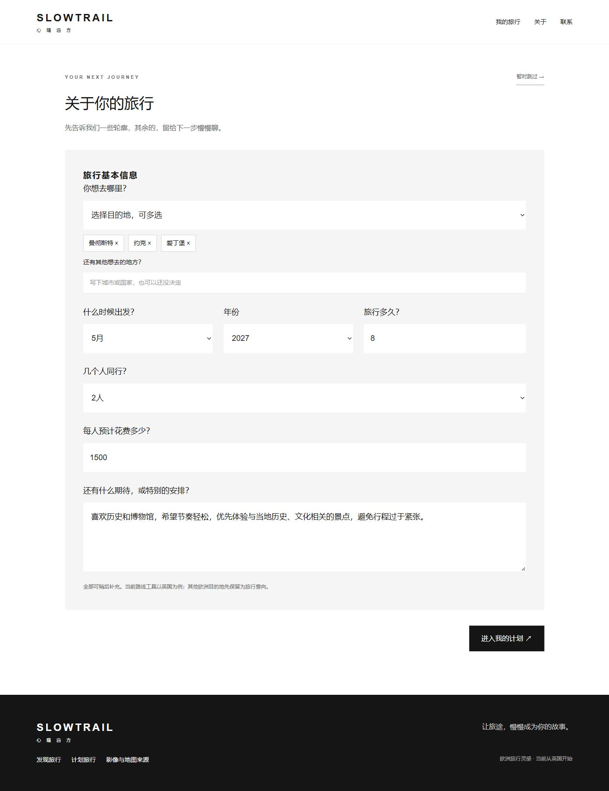
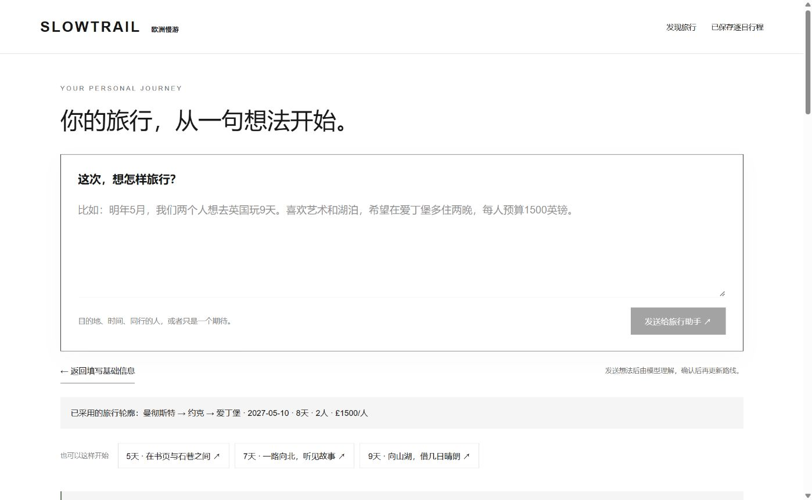

# Slowtrail 迭代测试与改进报告

记录范围为2026年10月8日至14日，重点是从早期交互原型、有限真实 Agent 验证到两轮使用者反馈改版。当前版本形成「首页双入口 → 可跳过基本信息 → 完整计划页对话 → 确认后更新路线」的连续流程。项目负责人最新评价为“基本已经好了很多”；复杂行程可靠性、全程交通与逐日自动规划仍需下一轮完善。

## 反馈来源和评估方式

反馈包括负责人转述朋友/同学的非正式体验意见，以及负责人直接提出的视觉和流程修改要求。原意及逐项处理见[反馈记录](feedback-2026-10-13.md)。没有可核实的样本量、访谈录音或改版前后任务成功率，因此不写满意度提升、转化率或用户数量。

电脑验证分为离线规则测试、实际接口请求、浏览器操作与真实模型调用。离线通过说明相关规则在测试条件下符合预期；真实模型结论仅限实际运行的场景。390×844模拟视口不等于实体手机性能验收。

## 迭代顺序和方向变化

| 时间 | 触发问题 | 处理与结果 |
| --- | --- | --- |
| 10月8日至9日 | 初版需要完整交互和真实资料 | 建立需求确认、固定示例工作区、地点与地图联动；补充三城30个带来源地点及时间检查工具。示例编排与资料分别标识。 |
| 10月10日 | 希望学习 WAY 的滚动同步与展示 | 加入章节图文、欧洲品牌和真实加载状态；根据“首页不应过早规划”移除一天地图操作，改为定制特点与案例展示。 |
| 10月10日至11日 | 功能测评发现核心 Agent 未接入 | 补模型适配、工具、补问、失败处理和预算保护；用户指定 GPT-4.1 与累计1美元后进行真实验证。 |
| 10月11日 | 修改入口不能只记录想法 | 完成锁定、替换、移动、差异确认、撤销重做、本机保存及备份；伦敦三天真实生成与一次局部修改成功。 |
| 10月12日 | 跨城、增减天数和连续修改需验证 | 三城五天真实生成失败；免费修复结束策略和保护规则，保留未完成真实复验结论。 |
| 10月12日 | 不应继续以伦敦、牛津、巴斯为产品锚点 | 英国路线独立建模，加入更多目录据点、自定义小镇、交通边界和官方入口，再补新据点逐日资料。 |
| 10月13日 | 朋友反馈入口重复、核心难找、页面沉闷、强制填写 | 四组反馈驱动首页、独立双入口、三条英国提案和可跳过需求页改版。 |
| 10月13日至14日 | AI图不真实，新版标题和计划路径仍不合适 | 改实拍，随后完成六项第二轮调整，把真实需求助手直接放在完整计划顶部。 |

欧洲是长期定位，英国是当前深入案例。欧洲摄影与其他国家意向输入不代表已经接入各国景点、交通或逐日规划。

## 使用者反馈和具体解决方法

### 首页过早开始规划

负责人先指出首页一天行程地图不必要，希望先展示可定制的特点和成果。按 WAY 分屏和案例结构移除首页地图操作，改为特点展示和编辑案例。后来朋友又反馈下滑内容过重、看不出该点哪里，第二轮进一步缩减补充内容，让首屏两条主入口承担核心操作。

最终首页不要求填写日期或需求。“发现旅行”进入提案，“计划旅行”进入基础表单；底部按钮进入相同计划入口。浏览展示不隐式修改需求。

### 按钮重复 定制入口和输入框难发现

朋友的转述意见是：“发现旅行灵感”和右上“寻找灵感”指向相同下滑内容，找不到定制入口，好不容易找到后输入框又小、信息密集。

解决方法是独立 `/journeys` 和 `/plan` 两条路径，导航保留我的旅行、关于、联系等辅助入口。没有账号服务时不伪造登录。删除输入周边“你的停留、你的节奏”等重复说明，让完整计划页顶部大对话框独立呈现。桌面输入框约190像素高，390像素宽模拟手机约210像素高，说明、示例和返回表单置于下方。

提案详情可以作为定制起点，输入示例仅填入文字、不自动调用模型。发送后理解需求，候选必须经“采用并更新下方计划”才改变路线。

### 文案呆板 字体和动态不合适

第一轮反馈认为“欧洲很大，按你的节奏出发”怪异、字体呆板。初改为“心之所向，即是远方”及粒子标题；负责人继续指出居中、过大、楷体不合适，希望小幅持续动态和更自然的表达。

最终主标题“把寻常，留在身后。让远方，慢慢发生。”在左侧以较小无衬线字体呈现，轻微持续粒子漂移和鼠标互动。理念改为“走过风景，把日子过成喜欢的模样。”，链接为“关于这场旅行”，案例区为“沿途，皆是心动。”。减少动态偏好下静态降级，隐藏或离开视口时暂停动画计算。

### 英国AI图饱和度高 缺少生机 地图不对应

负责人直接指出首批三图饱和度高、真实性低、没有生机，半透明地图与实际地理不符。

三张被否定图片退出网站素材，保留本机归档。第一轮纠正使用有来源的爱丁堡、德文特湖、伦敦实拍，独立地图依据对应地区公开地理数据绘制，标为地理概览、非透视配准导航。

第二轮又要求移除伦敦街头图，最终五图为爱丁堡、布莱德湖、德文特湖、牛津、巴斯，首屏地图覆盖和播放暂停按钮移除，保留手动切换。布莱德湖按真实地点标示为斯洛文尼亚。理念区另用负责人提供的罗马、佛罗伦萨、威尼斯三图，避免与首屏重复。庆祝参考图经AI去除原站文字和界面覆盖，不作为本站客户照片。来源、许可和编辑事实见[素材记录](image-credits.md)。

### 页面沉闷 下滑杂乱 案例和城市重复

朋友希望白底、黑白文字、摄影为主，负责人建议参照 Black Tomato 的短图文和卡片。第一轮加入简短理念、英国提案和城市卡片；第二轮进一步指出城市条重复、案例应使用深色横向结构。

最终理念区白底加错落三图，案例区深底白字、左侧短引导和右侧横向高图卡，桌面按钮滚动、手机可滑动。移除城市卡片条，底部改完整庆祝摄影和统一计划按钮。首页主叙事不再堆“真实界面、固定示例”等工程化小字，相关能力说明保留在价格、操作和来源处。

三条原创英国提案为“在书页与石巷之间”5天、“一路向北，听见故事”7天、“向山湖，借几日晴朗”9天。详情有逐日编辑建议、住宿分配和预算拆分，金额按住宿、餐饮、交通、活动假设计算，不能当作实时套餐报价或可预订价格。

### 强迫先填需求 基础信息和聊天分离

朋友不喜欢首页底部突然要求填计划。负责人第二轮要求基础表单可跳过，填或不填都进入完整计划，想法输入不应另开独立步骤。

按参考咨询页做中文目的地、月份、年份、时长、人数、每人预算和补充期待，右上“暂时跳过”，不以“何时抵达英国”限定通用产品定位。英国以外意向可记录，但工具范围明确。

填或跳过都进入 `/plan/route`。模型收到已填信息和连续对话；遗漏时间、天数、人数等信息时补问，不擅自编日期或预算。候选和已采用需求分开，返回表单可补充。纯偏好改变不重排手动住宿；日期或据点改变清除需重查航班和交通。等待模型期间用户若又编辑路线，旧候选不能覆盖新修改。

### 英国线路不能固定围绕三城

负责人要求包含爱丁堡、曼城及各种小城市，先打通英国路线和机场交通。为此建立独立的目的地、住宿据点和分段交通领域，而非仅给三城旧表单增加按钮。

现有25个目录据点、自定义待核实小镇，支持顺序、晚数、日期、四座机场、北爱跨海边界、官方查询、保存和备份。逐日资料新增曼城、约克、爱丁堡、皮特洛赫里11处地点，手动安排与免费检查可用。未覆盖资料、未知交通和自定义地名保持待核实。

## 测试发现的问题和工程修复

| 问题 | 修复和验证 | 当前结论 |
| --- | --- | --- |
| 首次模型连接失败，无用量回执 | 保留预算预留；启用已有进程代理，免费目录请求验证连通 | 后续限定真实测试成功，失败预留未清空 |
| 三城五天生成空白日，修正后耗尽轮次 | 汇总日期错误，明确留白边界，提示剩余次数，末两轮保留提交工具 | 离线与接口通过，修复后真实复杂生成仍未复验 |
| 缩短天数可能删锁定/固定安排 | 调用前保护，非法修改拒绝且原版本不变 | 离线、接口、导入样本浏览器通过 |
| 日期、晚数或顺序改变沿用旧交通 | 清除需重新查询的记录，保留仍有效机场选择 | 排序、日期与航班同步检查通过 |
| 新标题受到旧全站样式污染 | 隔离展示样式和响应式布局 | 新页桌面及窄屏通过 |
| 手机编号换行、表单标题挤压字段 | 重排底部，首字段清除浮动 | 390×844复验通过 |
| 旧路线样式压缩对话框 | 独立作用范围和输入尺寸 | 手机210像素、桌面190像素检查通过 |
| 返回表单或刷新丢手动晚数 | 保存工作草案，只应用真正改变的字段 | 手动3/2/2晚，刷新和往返后保留 |
| 补问忘记未采用轮廓 | 保留已理解候选作后续上下文 | 两轮真实测试保留城市和偏好 |
| 受限环境无法构建、访问本机或网络 | 按权限机制恢复正常本机执行；浏览器明确拒绝时停止 | 环境限制与产品缺陷分别记录 |

## 验证结果和模型费用

| 日期与版本 | 离线测试 | 接口与界面记录 |
| --- | --- | --- |
| 10月9日资料工具 | 23项通过 | 26项HTTP工具检查；当次浏览器受策略限制，未做视觉实测 |
| 10月10日首页和测评 | 24项通过 | 章节、偏好、地图、工作区、模拟手机；之后移除提前规划 |
| 10月11日模型与版本 | 53项通过 | 10项HTTP；伦敦真实生成和局部修改、冲突拒绝、锁定、恢复 |
| 10月12日复杂修复 | 64项通过 | 6项HTTP及锁定样本；三城真实生成失败 |
| 10月12日英国路线 | 79项通过 | 7个HTTP入口；小镇、排序、跨海、保存、损坏导入 |
| 10月13日第一轮改版 | 94项通过 | 14个HTTP入口；双路径、详情、预填、跳过、恢复 |
| 10月14日第二轮和需求助手 | 102项通过 | 桌面、390×844；空白跳过、填表、对话、采用、往返、刷新 |

各版本最终 lint、typecheck、build 通过。上传准备再次运行102项测试、lint和typecheck，均通过；报告整理未改变应用源码，沿用上一轮成功生产构建。测试数量增加不等于模型准确率提升。

旧工作区伦敦三天真实生成含5个景点、12次实际工具返回，保留必去和固定会面；一次局部修改只移除目标景点并保留锁定及固定活动。三城五天真实生成没有形成可采用结果。

新需求助手第一次输入曼城、约克、爱丁堡、历史博物馆和轻松节奏，却未给时间/天数/人数，模型补问而不猜测；第二次补2027年5月10日、7天、2人、每人1500英镑，沿用城市与偏好。采用后三站六晚。此结果验证需求理解和轮廓更新，没有验证全程交通或逐日自动安排。

| 累计账本节点 | 占用美元 | 说明 |
| --- | --- | --- |
| 10月11日限定真实流程后 | 0.253920 | 有效回执估算加首次未知失败预留 |
| 10月12日复杂测试后 | 0.593308 | 失败测试和历史预留保留 |
| 10月14日两轮助手后 | 0.599882 | 新增0.006574，沿用原1美元额度 |

两次助手调用分别888输入/180输出和1075输入/151输出 token，估算0.003216和0.003358美元。累计含保守预留、忽略缓存折扣，实际扣费以平台为准。名义剩余约0.400118美元，还受请求前预留与余量保护限制。本次报告上传不新增模型调用。

## 当前完成度与未完成事项

| 能力 | 当前状态 | 下一轮重点 |
| --- | --- | --- |
| 首页与双入口 | 两轮改版已实现，负责人定性确认更好 | 实际任务观察与手机体验 |
| 基础信息和连续需求对话 | 已实现，两轮真实补问/确认通过 | 歧义、矛盾、取消和遗漏场景 |
| 英国住宿路线 | 25目录据点、自定义小镇、编辑和规则计算 | 顺序合理性、交通耗时和转场质量 |
| 新英国逐日流程 | 手动资料/检查可用，模型代码已接入 | 真实验收、跨天去重与整条编排 |
| 旧三城 Agent | 有限真实成功与版本能力 | 复杂生成修复后复验 |
| 航班、交通、价格 | 官方入口和手填；实时提供商未配置 | 服务选择、成本、实际接驳 |
| 全欧洲、语音、云账号、预订 | 尚未接入 | 另定范围和资源 |

聊天及未采用候选没有完整刷新恢复；已采用基础信息与路线草案有本机恢复。新逐日页未具备旧工作区同等锁定、多版本撤销。资料是核对日期快照，真实天气、闭馆、预约和末段交通仍需另查。

## 最新版页面示例

截图为本地工程检查，测试字段不是客户计划或真实出行。过程事件、账本和其余原始截图保留本机，公开仓库提供报告及精选页面证据。

## 下一轮建议

先观察使用者完成两项任务：从提案进入自己的计划，以及从空白描述需求、补遗漏、确认路线。记录能否找到入口、理解候选与已采用区别、返回改信息、在手机操作，以及具体卡点。负责人评价更好仍应结合这些任务判断。

功能上优先英国路线合理性和新逐日能力，再考虑实时交通。新逐日真实测试需单独恢复对应流程并沿用原账本；收费交通、其他国家和公开应用部署另定范围。新对话从[交接文档](next-iteration-handoff.md)承接，等待下一轮具体问题。
